<div align="center">


# Big Game Mode

**BigLinux's game mode.**<br>
One switch for per-game performance, presets for what games should favour,
a library that says how each game runs on Linux, AI Graphics with full backup
and undo, and pages that show — with evidence — what is really in effect.

[](https://github.com/biglinux/bigamemode/releases)
[](LICENSE)
[](https://www.rust-lang.org/)
[](https://gnome.pages.gitlab.gnome.org/libadwaita/)
[](#languages)

[What's new](#whats-new-in-300) ·
[Tour](#a-tour-of-the-application) ·
[Features](#features) ·
[Game information](#game-information) ·
[Installation](#installation) ·
[Troubleshooting](#troubleshooting) ·
[Security](#security) ·
[Development](#development)

<br>

<picture>
  <source media="(prefers-color-scheme: light)" srcset="docs/screenshots/home-light.png">
  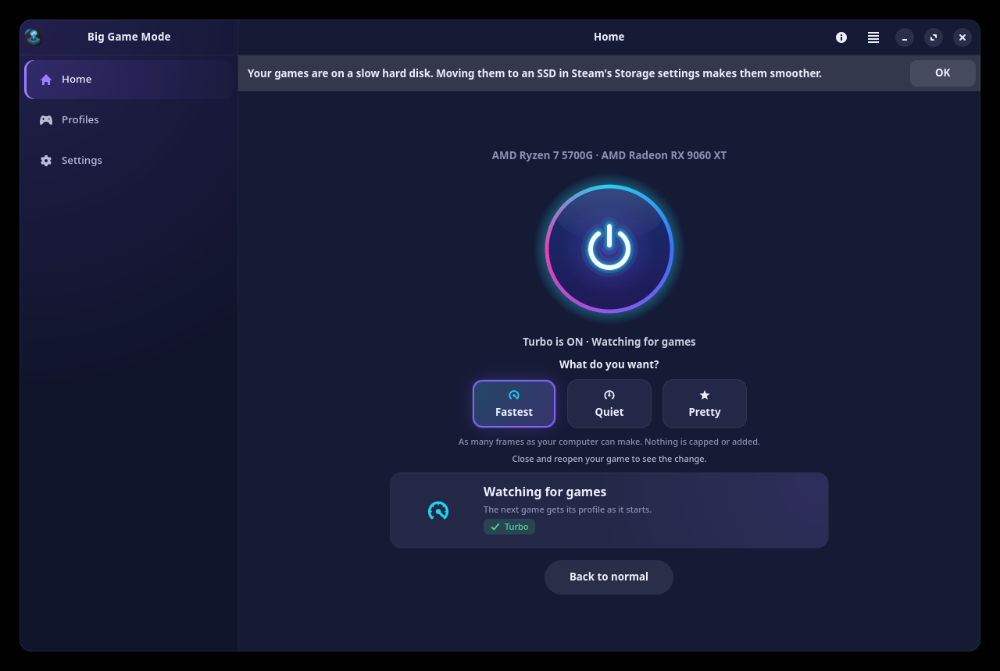
</picture>

</div>

---

## What it is

Big Game Mode (the BiGame-mode project) is the gaming hub of BigLinux. With one
button, **Turbo**, every game gets its own performance profile, applied by
[falcond](https://git.pika-os.com/general-packages/falcond) when the game
starts and undone when it closes. The application finds every game installed
by Steam, Heroic, Lutris, Faugus or the application menu; says how each runs
on Linux, whether its anti-cheat allows online play and how many play it;
shows what is really in effect; measures whether a change helped; and takes
care of what happens *inside* the game — upscaling and frame generation —
always with a backup and a way back.

> [!NOTE]
> One rule runs through the project: **nothing is offered that the machine
> cannot do, and nothing is called an improvement without a measurement.**
> Nothing is changed in bulk either: there is no "apply all", a DNS server is
> never changed and a program never paused or closed without you asking.

## What's new in 3.0.0

**A new layout, one purpose per page.** Seven pages became six, in the order
a person uses them:

| Page | What it holds |
|---|---|
| **Home** | One **Turbo** card — the switch, the three presets under it with what the chosen one does, and Back to normal — and a **Now** card with the game being played. |
| **Games** | The library (formerly Profiles): every installed game, its profile, its compatibility, anti-cheat and players. |
| **Optimization** | Tabs: **Overview**, **Tuning**, **Details**, **Network and apps**. |
| **Telemetry** | The live charts, second by second. |
| **Records** | Tabs: **Reports**, **Games that crashed**, **Logs**. |
| **Settings** | Appearance, background start, notifications, game information, advanced options. |

- **Recommendations instead of Problems:** each says whether it is
  *Recommended*, needs your *Attention*, is *Not supported* on this hardware,
  is *Informative*, *Already adequate*, or *Needs measurement*, and leads to the
  page that changes it.
- **Every game's Linux compatibility, anti-cheat and players** — Steam's
  games and, from 3.0.0, those of Heroic, Lutris and Faugus too: a Linux build
  says **Native**, a Windows one is matched to its Steam version by its exact
  title. See [Game information](#game-information).
- **The Now card** on Home: the game's cover, launcher, how long it has run,
  its ProtonDB and anti-cheat tags, and one coloured flag per feature it
  really got (active, configured but not seen, off, unavailable).
- **Simple and advanced share everything:** simple mode hides the Tuning,
  Details and Logs tabs instead of whole pages, and a page saved by an older
  version opens where its content went.
- **Icons that are not in every theme** ship with the application, so no
  page shows a missing image outside BigLinux's icon theme.
- A game whose anti-cheat refuses Linux is said before **Play**, and the
  window never leaves the focus on a notice's button (keys meant for a game
  could press it).

<details>
<summary><b>Earlier versions</b> (2.3.0 to 2.4.1)</summary>

### 2.4.1

**A game that crashes is said, with what was in it.** Cyberpunk 2077 closed
after 25 minutes on an access violation in its own scripts, and Big Game
Mode only said "Cyberpunk 2077 closed", as for a game quit from its menu.

- **A crash is told from a quit,** from what it leaves and only what was
  left while the game ran: the game's own crash report (REDengine, Unreal
  Engine, Unity), a crash reporter still open, how the kernel says the
  process ended (a crash signal, or the code Wine ends a Windows game with
  when an exception stops it), the kernel's out-of-memory killer, and
  systemd-coredump's record.
- **The notice says what was in the game** besides the game itself (vkBasalt,
  FSR 4, Wine FSR, MangoHud, lsfg-vk, OptiScaler, Gamescope), read from the
  game while it ran, never from settings, with the game's reason and how
  many times it crashed this week.
- **Leave them out of this game:** one button keeps vkBasalt, FSR 4 and
  Wine FSR out of that game alone from its next start, written where its
  launcher reads it (an open Steam is closed and opened again around the
  write, never while it runs a game). Nothing changes until it is chosen;
  Games puts them back.
- **FSR 4 can be switched off for one game**, whatever the Pretty preset
  asks for the others.
- Details lists the last crashes, the support report carries them, and
  falcond's VRAM protection error is said in your language.

### 2.4.0

**First, do no harm.** A full review asked one question of every feature:
can it make a game slower without saying so? Where it could, it no longer
does.

- **Three presets, honest names.** **Fastest** adds nothing, **Quiet** caps
  the frame rate at a rate that fits the screen (the refresh rate up to
  75 Hz, half of it above: 80 on a 160 Hz screen, so every frame stays up
  for exactly two refreshes), and **Pretty** sharpens with no cap. Before,
  *Locked 60 FPS* and *Enhanced graphics* capped every game at 60, which on
  a 144–165 Hz screen without adaptive sync judders. A game that generates
  frames is never capped (under 60 it rendered 30). Saved presets load as
  the one that took their place.
- **A game's frame limit without Gamescope.** It used to start nested
  Gamescope for `-r`, which did not limit and made frame pacing worse; now
  DXVK and VKD3D-Proton hold it (MangoHud in native games).
- **Profiles keep falcond's protections:** a game's own profile no longer
  drops the VRAM protection and split-lock setting falcond's Proton profile
  gives every Proton game. No CPU scheduler is pressed on anyone: none was
  measured faster, and one set for the whole desktop is pointed out.
- **Out of the way while you play.** Nothing is read behind a game (a
  Details page left open used to read the game's memory map and the GPU's
  sensors every few seconds), the game's exit is an event instead of a
  process scan, the library is not rescanned during the game, in-game
  notifications wait in the notification list, and Big Game Mode's disk
  reads yield to the game's.
- **AI Graphics' Recommended installs only what was verified;** a game
  that ships AMD's FidelityFX API keeps its own FSR (FSR 4 through Proton)
  on RDNA 4, and OptiScaler's frame generation is an experimental choice,
  never planned on a GeForce GTX.
- **Simple mode, the default:** Turbo says ON or OFF in words, three
  choices, **Play** on every game and **Back to normal** to undo it all.
  Settings → Advanced brings Tuning, Details and Logs back.
- **Telemetry has its own page**, in the sidebar in simple mode too: the
  processor, memory, disk, network and one card per GPU, each with a chart
  of the last minute. The cards keep their size and place whatever the
  readings say, and the whole page fits the window.
- **One look on every page:** Home, Profiles, Tuning, Details, Logs and
  Settings use Telemetry's cards, with an icon and a title in each card's
  header, laid out in columns on a wide window and one under the other on a
  narrow one. Turbo's button is as it was.
- **What no setting fixes, said plainly:** a game library on a hard disk,
  adaptive sync switched off, and Steam launch options with a wrapper but no
  `%command%` (with a one-click fix).
- **No scheduler left behind:** a sched-ext scheduler nobody asks for (left
  by falcond, which put it back after every game) is unloaded as Turbo
  switches, and saving Tuning no longer restarts falcond under a running
  game.
- **AI Graphics, safer to leave:** every game's graphics restored in one go
  (Settings → Advanced, or `bigame-ui --restore-all-graphics` before removing
  the package), and a game that got anti-cheat in an update while OptiScaler
  is in it is named.
- **Lighter in the tray:** about 117 MiB after the window closes, from about
  480 MiB.

### 2.3.2

A stability release, from a full review of the code, the helper and the
package.

- **Turbo on processors falcond cannot run on** (Sandy Bridge, Ivy Bridge and
  older with a falcond built for x86-64-v3) no longer switches itself off a
  few seconds after it starts, while the power profile stayed at performance.
  See [CPU compatibility](docs/CPU-COMPATIBILITY.md).
- **Nothing left behind:** turning Turbo off or changing the preset reaches
  Steam and Heroic once they are closed, and deleting a profile takes its
  launch options out of Steam, Heroic and Lutris. Profiles says which launcher
  to close when one was open.
- **Your settings stay yours:** only what Big Game Mode added is removed,
  account by account (a native and a Flatpak Steam are two installs); your
  own launch options, Lutris' MangoHud line, and MangoHud and vkBasalt files
  (also ones that are not UTF-8, and dotfile-manager symlinks) are kept.
- **AI Graphics** makes one change at a time to a game, so a double click can
  no longer mix two installs' backups; Restore from Profiles works as on the
  AI Graphics page.
- **Idle cost:** one systemd reading for the tray and Home, no property cache
  traffic, slower polling while a game runs, and nothing woken while the
  window is hidden.
- **Game detection:** Electron/Chromium helpers, the Steam runtime's locale
  tools, Windows installers (`msiexec`, .NET) and crash reporters are not
  taken for the game.
- **A stricter helper:** `/run` and the machine-wide `/sys` trees read-only,
  memory and task limits, no systemd reload when nothing changes, profiles
  named after system processes refused. Its Polkit messages are now
  translated with the rest of the application.
- **Quality:** Rust 1.88 declared (the real minimum), French, Chinese and
  other languages get their own "label: value" punctuation, and the About
  dialog names the developer.

### 2.3.1

- Processors without AVX2/BMI2: a falcond built for x86-64-v3 is named as
  the cause instead of a retry being suggested, and Turbo comes on with the
  general settings
  ([#4](https://github.com/biglinux/bigamemode/issues/4)).
- A falcond that crashes at start no longer stays enabled; the Steam
  runtime's `ldconfig` is not taken for the game.

### 2.3.0

- **Big Game Mode** is the name you see everywhere; package names, the
  application id and file locations are unchanged.
- **The tray is a quick control:** Turbo on or off, the four presets, and its
  own symbolic icon drawn in the panel's colours.
- **Launchers opened before a preset** (Steam, Heroic, Lutris) are offered a
  reopen from a notice at the top of any page, never while one of their games
  runs.
- **Profiles:** the wizard is the main way to create one, and a profile can be
  started from its editor with **Launch (Turbo)**. Home names the CPU and every
  GPU, the gaming one first on hybrid laptops.
- **lsfg-vk 2.x:** its configuration format is read from the installed
  library and written in that format; a `Lossless.dll` lsfg-vk cannot use is
  reported instead of letting the game fail.
- **Hybrid NVIDIA laptops:** Gamescope no longer crashes (the render-offload
  variables reach only the game), and nested Gamescope shows the game the
  screen's size instead of 1280×720.
- **Turbo** rolls back cleanly when falcond fails to start, and a preset leaves
  nothing behind once Turbo is off. Restore Defaults now resets everything
  Tuning shows.
- **Game detection** reads Steam, Heroic and Lutris libraries directly and no
  longer takes launchers, trials, bootstrappers or scripts for the game.
- **AI Graphics:** frame generation is shown active only when OptiScaler's log
  proves it; Restore and Repair are safer; the download cache keeps only the
  releases games use; a game's built-in FSR under VKD3D-Proton stays its own.
- **A stricter privileged helper**, and about 0.15 % of one CPU core while idle
  in the tray (2 % before).
- **No extra repository needed:** falcond, lsfg-vk, sched-ext, Gamescope,
  MangoHud and vkBasalt are optional. What needs one says so and how to
  install it.

<details>
<summary><b>2.2.0 and 2.1.0</b></summary>

- **2.2.0:** a welcome screen, a rewritten About and Help; Tuning with
  Gamescope always in view and vkBasalt looks (CAS or the Nara Linux style);
  game profiles with the same rows as Tuning, reaching Steam and Heroic games;
  Launch (Turbo) through every launcher; a redesigned AI Graphics window;
  background programs can be closed or paused, a measured DNS applied with a
  backup, and falcond handed back and taken again.
- **2.1.0:** Turbo presets chosen before switching it on; a redrawn Home;
  Tuning, game profiles and the profile wizard on one model with every
  conflict asked; Gamescope and Wine FSR reach Steam games through their launch
  options; Details tells when falcond does not apply a game's profile, and why.

</details>

</details>

## A tour of the application

### Home


- **Turbo** is the master switch. The disc fills as each part of Turbo is
  really applied, and the line under it says which; the machine is named
  under it (processor and the GPU games render on).
- **What do you want?** — *Fastest*, *Quiet* or *Pretty*, chosen before or
  while Turbo is on (see [Turbo and presets](#turbo-and-presets)).
- **Back to normal** turns Turbo off, brings the choice back to Fastest and
  every setting to how it started. Your games are not touched.
- **Now** shows the game being played with its cover, launcher, runtime
  (Proton version or native) and graphics API, how long it has run, its tags,
  and one flag per feature as Big Game Mode reads it from the running game:
  the profile, scheduler, power profile, Gamescope, upscaling, frame
  generation, MangoHud, vkBasalt and the frame cap. **Create profile** appears
  when the game has none; **View the Turbo report** opens it in Records. With
  no game, it says what Turbo is doing and where to start one.
- In advanced mode, **Live readings** follow: CPU clock, GPU load, latency.

### Games

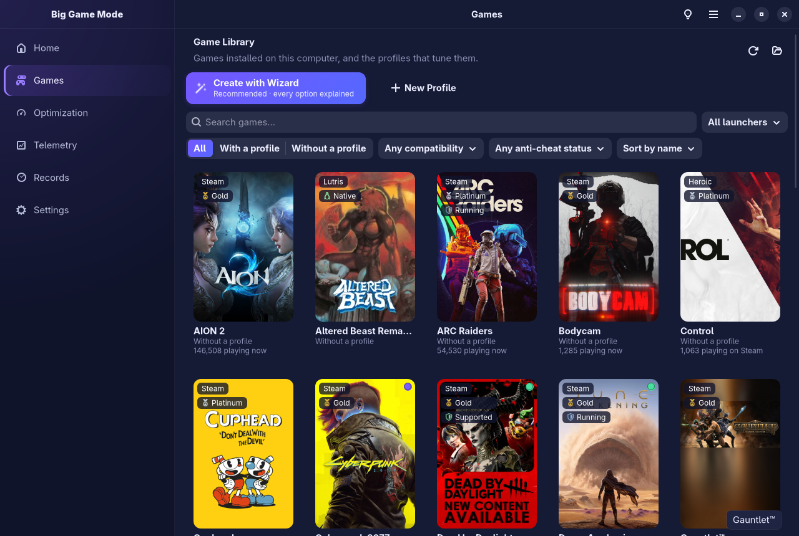

Every installed game, from every launcher, with its cover, its profile (a
green dot is yours, a blue one ships with falcond), its compatibility tag,
anti-cheat tag and players. Search by name, filter by launcher and by
whether it has a profile; in advanced mode, filter by compatibility and
anti-cheat status and sort by name, rating or players.

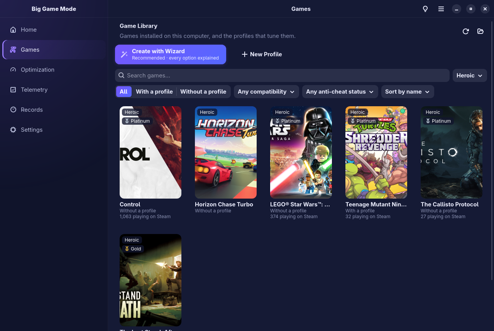

A game's menu has **Launch (Turbo)**, **Edit profile**, **AI Graphics** and
**Measure the difference**. Its page starts with **Game Compatibility** —
Linux compatibility, anti-cheat and Steam activity, each with its source,
its age and a link — and then the profile's sections:

<table>
<tr>
<td width="50%">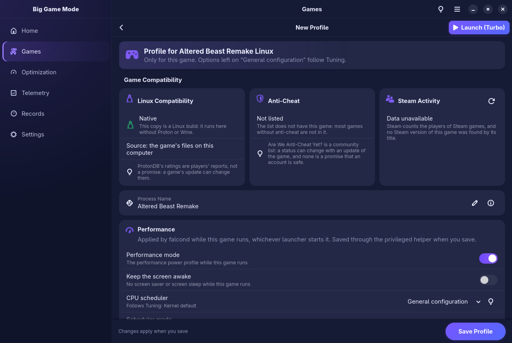</td>
<td width="50%">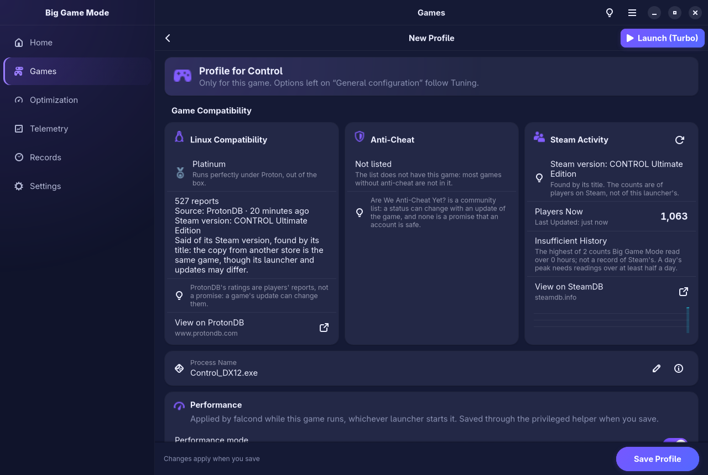</td>
</tr>
<tr>
<td align="center">A Steam game</td>
<td align="center">A Heroic game, said of its Steam version</td>
</tr>
</table>

### Optimization

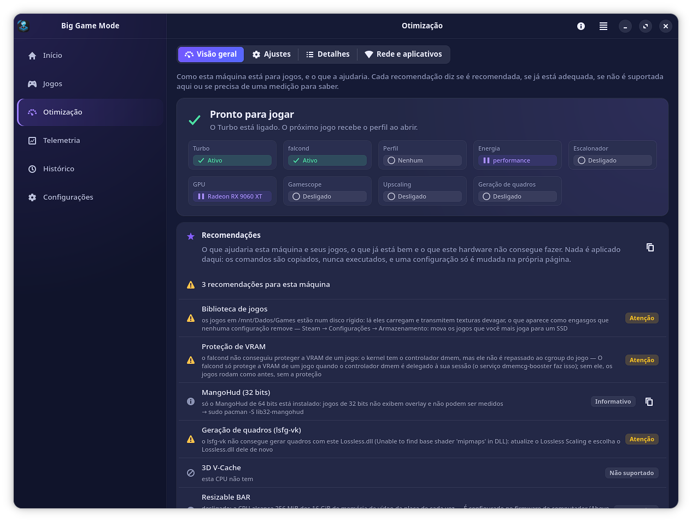

- **Overview**: a line on how the machine stands, a chip per item (Turbo,
  falcond, profile, power, scheduler, GPU, Gamescope, upscaling, frame
  generation), and the **Recommendations** for this machine's own hardware
  and packages — falcond and its profiles, sched-ext, 3D V-Cache, adaptive
  sync, Resizable BAR, NTSync, hybrid graphics, VRAM protection, 32-bit
  MangoHud, a game library on a hard disk and more — each with its state, the
  command to copy or a button to the page that fixes it, and the checks that
  passed. What only a measurement can tell is said as that.
- **Tuning** (advanced): the general configuration every game gets.
- **Details** (advanced): what is really in force for the game, item by item.
- **Network and apps**: the connection, a DNS comparison, the programs
  competing for the CPU, and Steam launch options that call a missing
  program.

<table>
<tr>
<td width="50%">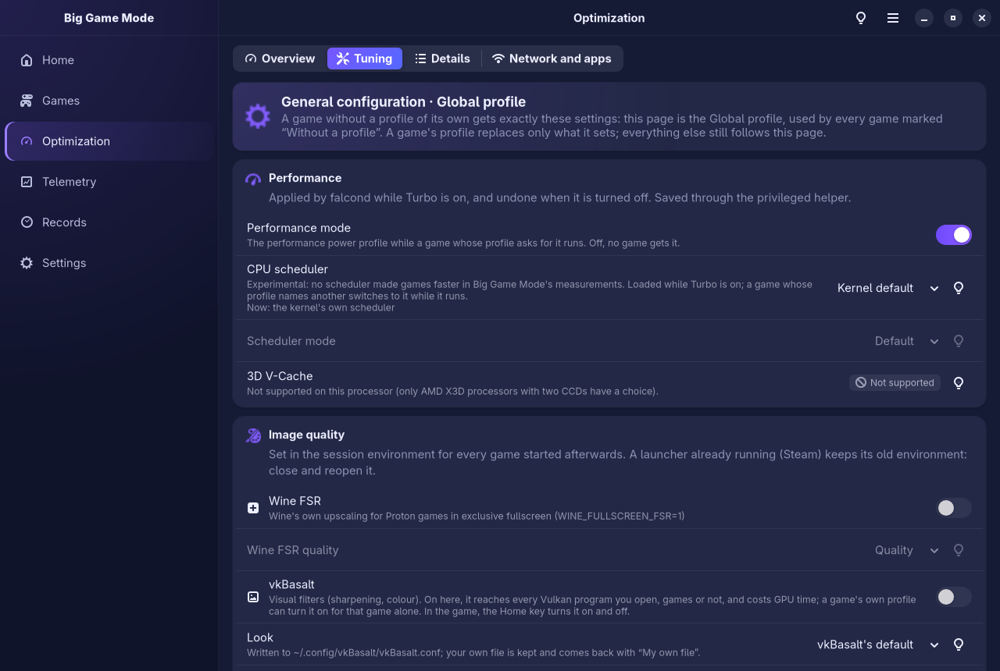</td>
<td width="50%">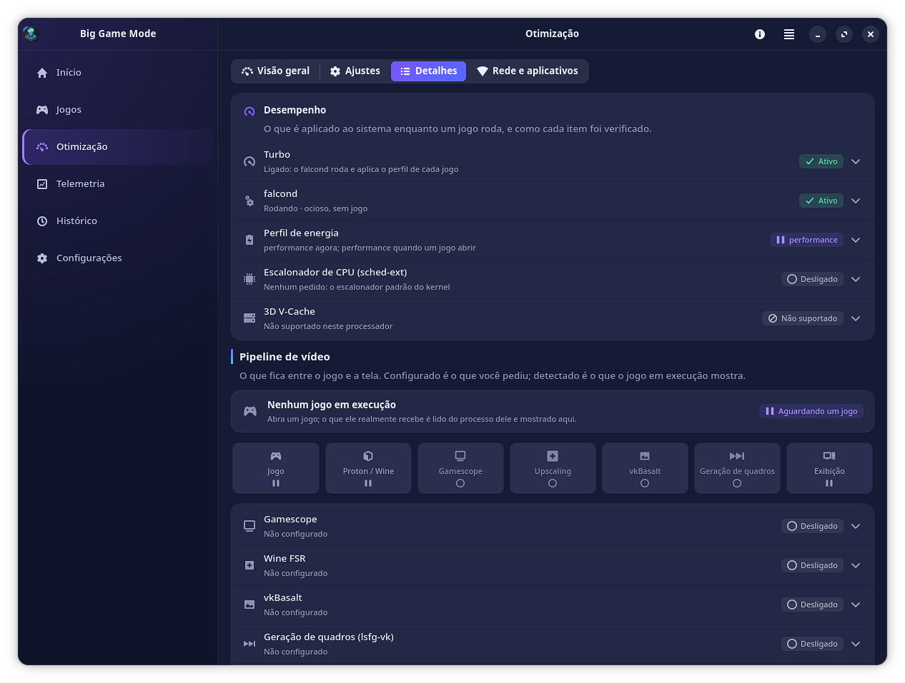</td>
</tr>
<tr>
<td align="center"><b>Tuning</b>: what the machine cannot do is shown as such</td>
<td align="center"><b>Details</b>: what is in effect, with the evidence</td>
</tr>
<tr>
<td>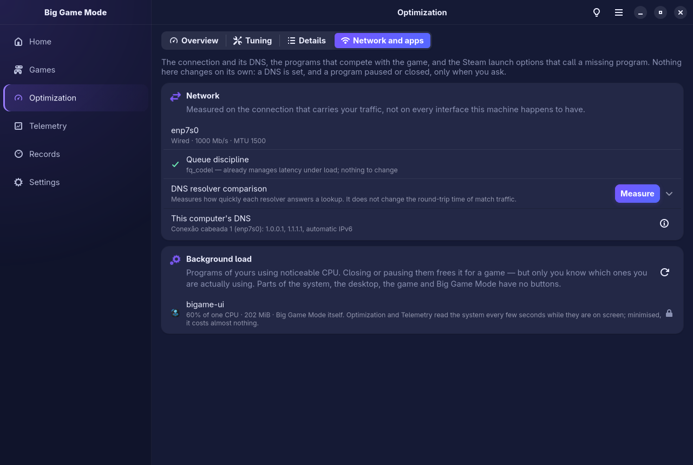</td>
<td>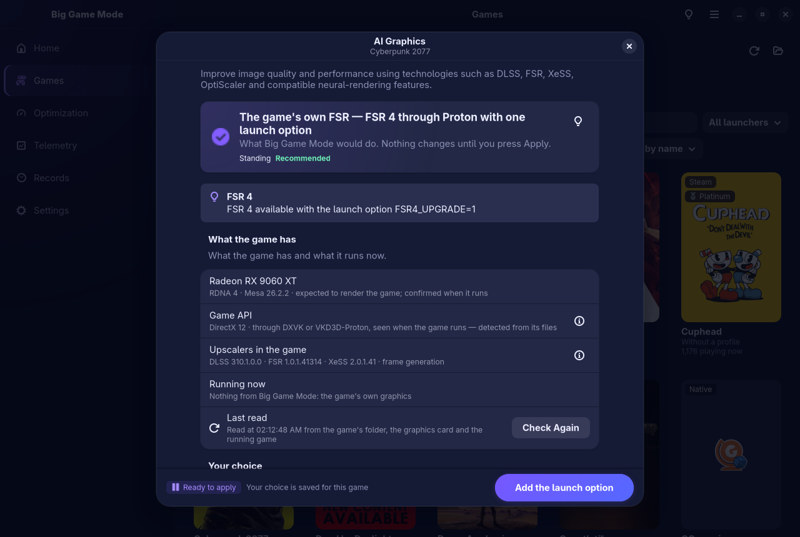</td>
</tr>
<tr>
<td align="center"><b>Network and apps</b>: nothing changes unless you ask</td>
<td align="center"><b>AI Graphics</b>, from a game's menu: the verdict first</td>
</tr>
</table>

### Telemetry

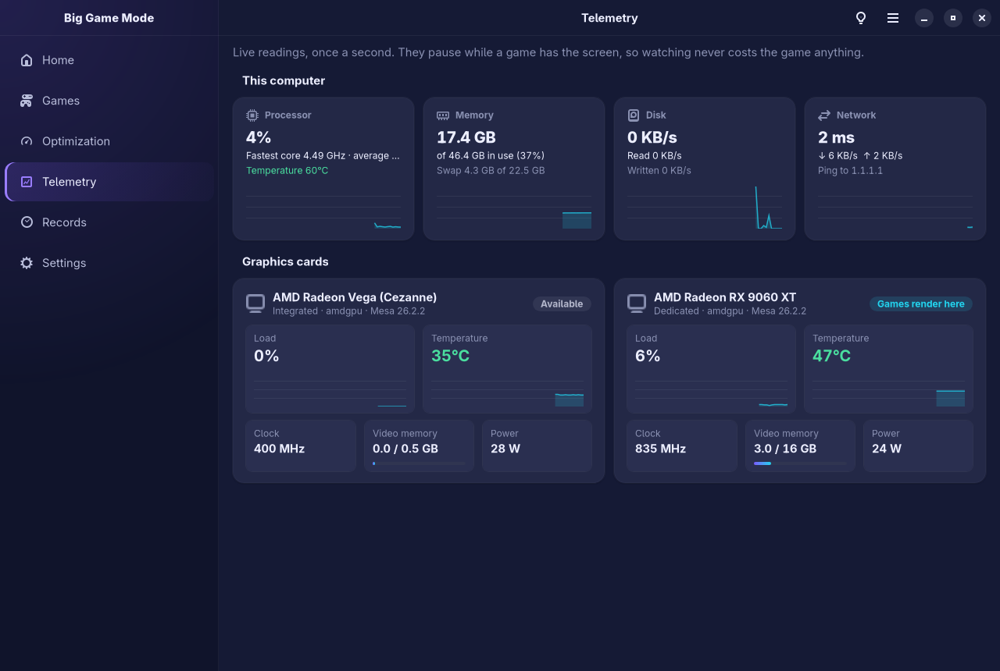

Once a second: the processor (load, the fastest core's clock and the
average, temperature), memory and swap, the disks, the network (latency,
received and sent) and every GPU (load, temperature, clock, video memory,
power, and which one renders the game), each with a chart of the last
minute. A reading the driver does not publish says so. Nothing is read while
a game has the screen.

### Records

<table>
<tr>
<td width="50%">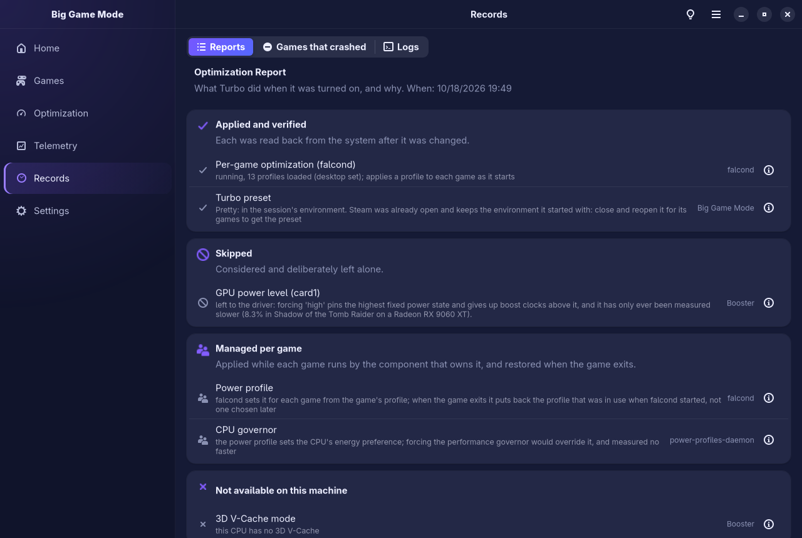</td>
<td width="50%">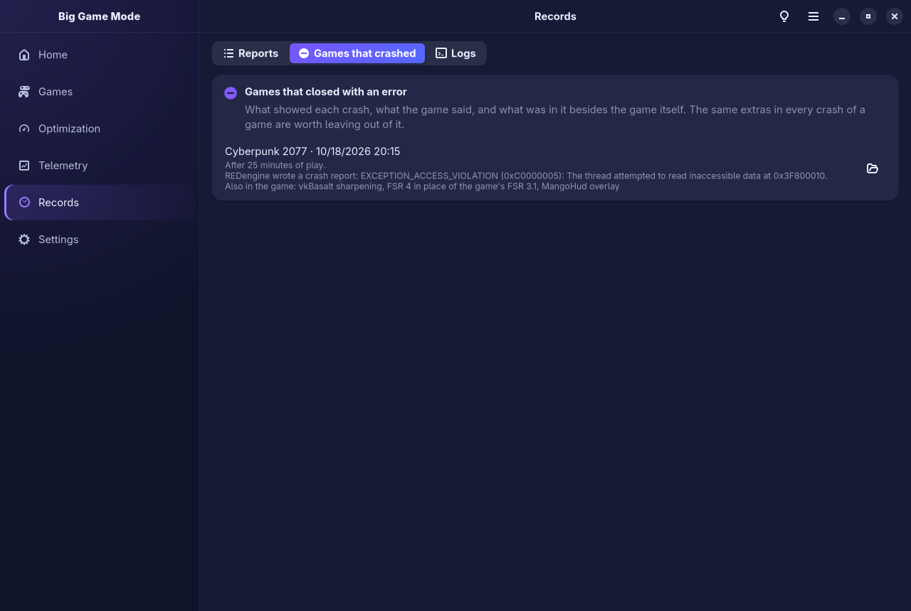</td>
</tr>
</table>

- **Reports**: the last Turbo report — applied and verified, managed per
  game, skipped, not available, conflicts avoided, failed — with what is in
  force right now, and the **support report** to paste into a forum or an
  issue (user name, home folder, host name and public addresses removed).
- **Games that crashed**: each game that closed with an error, when, what
  showed it (the game's own crash report, a crash reporter, how the kernel
  says it ended, systemd-coredump), what the game said, and what else was in
  it (vkBasalt, FSR 4, Wine FSR, MangoHud, lsfg-vk, OptiScaler, Gamescope).
- **Logs** (advanced): falcond, the helper, power-profiles-daemon,
  scx_loader, Gamescope, the GPU drivers and, from Steam games' output,
  Proton/Wine, MangoHud, vkBasalt, lsfg-vk and OptiScaler, filtered by source.

### Settings

<table>
<tr>
<td width="50%">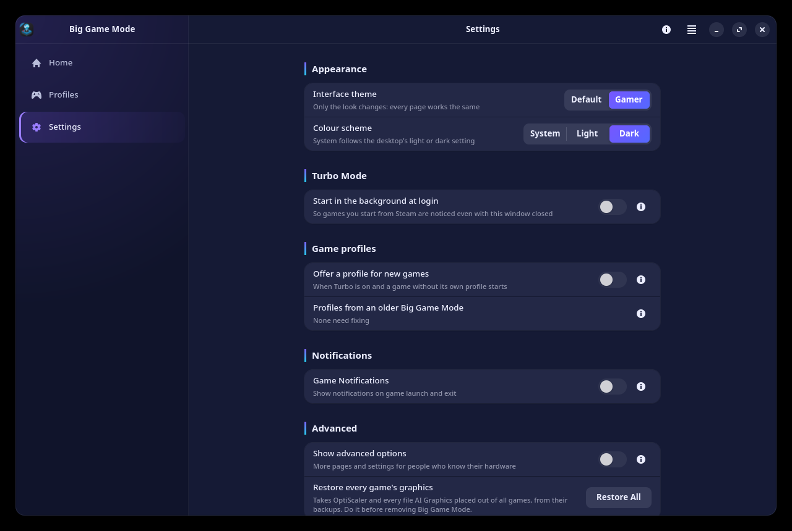</td>
<td width="50%">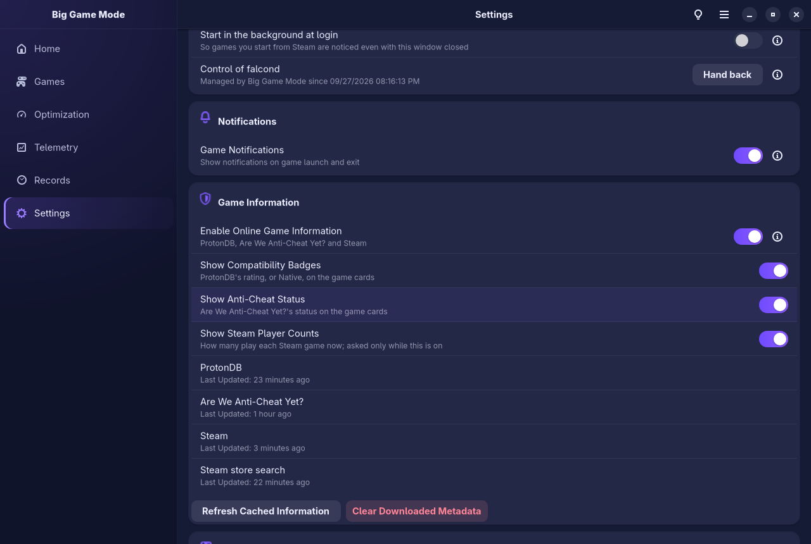</td>
</tr>
</table>

The Default or Gamer theme, light, dark or the system's; starting in the
background at login; handing falcond back as it was; notifications; **Game
Information** (each source on or off, when it last answered, refresh or clear
what was downloaded); and the advanced options.

<div align="center">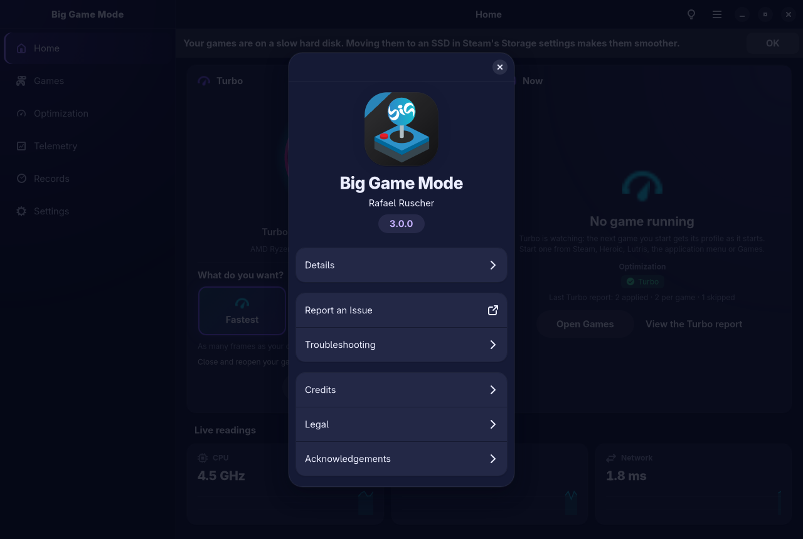</div>

## Features

### Turbo and presets

Turbo is the master switch. Off, Big Game Mode leaves every game alone. On,
falcond applies each game's profile — power profile, sched-ext CPU scheduler,
3D V-Cache mode, idle inhibition — and restores everything when the game
closes.

Before switching it on, choose what games should favour:

| Preset | What it does |
|---|---|
| **Fastest** | Nothing added: Tuning as it is, no frame cap |
| **Quiet** | A frame cap that fits the screen — the refresh rate up to 75 Hz, half of it above (80 on 160 Hz) — through DXVK and VKD3D-Proton in Proton games and MangoHud in native games Big Game Mode starts; games that generate frames are left uncapped |
| **Pretty** | vkBasalt CAS sharpening (from Big Game Mode's own CAS-only file) and FSR 4 where the GPU has it; no cap |

A preset lives only in the running session (the user's systemd manager, never
`environment.d`) and leaves with Turbo, even when falcond stops on its own. Your
own `DXVK_CONFIG` and FSR 4 variables are kept and given back.

### Per-game profiles

Games from **Steam**, **Heroic**, **Lutris** and the application menu, native
or Flatpak — only the ones really installed. When an unknown game starts with
Turbo on, a notification offers to create its profile with a wizard that
explains every option. A profile has the same sections as Tuning, each option
starting at "General configuration". What a game needs reaches it where it can:
through **Launch (Turbo)**, Steam's launch options, or the game's settings in
Heroic — written with the launcher closed, touching only what Big Game Mode
added.

### Launch settings: Gamescope, MangoHud, vkBasalt, frame generation

**Tuning** holds the configuration every game shares:

- system performance through falcond (scheduler, V-Cache, profiles);
- **Gamescope** with sizes picked from standard resolutions and the main
  screen's;
- **Wine FSR** and **vkBasalt** (CAS or the Nara Linux look);
- **frame generation** with [lsfg-vk](https://github.com/PancakeTAS/lsfg-vk)
  (1.x and 2.x, with your own `Lossless.dll`, never shipped or downloaded);
- the **MangoHud** overlay, with Steam Deck–like styles.

Two technologies that do the same job never run in series: enabling one while
the other is on asks which to keep. What the machine cannot do is shown as
**Unsupported** or **Not installed**, with the command that fixes it — never as
a broken control.

### AI Graphics (OptiScaler)

AI Graphics analyses the game that really runs (following launcher stubs to
the real executable): its graphics API, the DLSS/XeSS/FSR it ships as a DLL or
builds into the executable, proxy DLLs, anti-cheat and the GPU it renders on.
It shows the verdict first, then why, and what to set in the game's own menu.
Only **Apply** changes anything. It installs
[OptiScaler](https://github.com/optiscaler/OptiScaler) from the official
release (HTTPS, pinned SHA-256) with a verified backup, or raises FSR 3.1 to
FSR 4 through Proton. **Check Again**, **Repair**, **Restore** and **Diagnose**
are always there. Games with anti-cheat are never touched.

### Measure the difference

Compares a game with and without optimisations over several alternated runs
and gives a verdict with Welch's t-test. A gain is called one only when it
exceeds the run-to-run spread. Method and results:
[docs/BENCHMARKS.md](docs/BENCHMARKS.md).

### Crash watch

A game that closes is told from a game that crashed by what it leaves, and
only what was left while it ran. The notice names what was in the game
besides the game itself, read from the game while it ran, never from
settings; **Leave them out of this game** keeps vkBasalt, FSR 4 and Wine FSR
out of that one game from its next start, written where its launcher reads
it. Every crash is kept in Records.

### Tray

Closing the window keeps Big Game Mode in the tray, with Turbo, the presets and
**Open** a click away. On GNOME the tray needs an AppIndicator extension.

## Game information

Three questions, each answered by the source that can answer it, and each
said with that source, its age and a link to it:

| Question | Source | How it is asked | Kept |
|---|---|---|---|
| *Does it run well on Linux?* | [ProtonDB](https://www.protondb.com)'s rating (Platinum, Gold, Silver, Bronze, Borked); **Native** when Steam lists a Linux build, or when the copy installed is one | `protondb.com/api/v1/reports/summaries/<appid>.json`; Steam's own data on this computer | 24 hours |
| *Does its anti-cheat allow online play?* | The community list [Are We Anti-Cheat Yet?](https://areweanticheatyet.com) (Supported, Running, Planned, Broken, Denied) | its `games.json`, once for the whole library, with `ETag` | 12 hours |
| *How many play it?* | Steam's own counts and its Most Played chart | `ISteamUserStats/GetNumberOfCurrentPlayers`, `ISteamChartsService/GetGamesByConcurrentPlayers` | 15 minutes |

**Games from other launchers.** A Heroic, Lutris or Faugus game that is a
Linux build (Big Game Mode can start its file directly) is **Native**: it runs
here without Proton or Wine. A Windows build is looked for on Steam's store
(`store.steampowered.com/api/storesearch`) by its title. Only an app whose
name is the title — once case, marks such as ™ and ® and punctuation are set
aside — is taken, or one that differs only by an edition's name ("Ultimate
Edition", "Game of the Year Edition"…): *Control* is matched to *CONTROL
Ultimate Edition*, never to the sequel *CONTROL Resonant*, a DLC or a
soundtrack. What ProtonDB, the list and Steam say of it is said to be its
Steam version's: the tag's tooltip, its popover and the game's page name
that version, and the card says "playing on Steam". A title with no such
match shows nothing rather than a guess.

**Privacy and courtesy.**

- Only a game's public Steam number, or, for another launcher's Windows game,
  its title, is sent. Never your Steam account, your list of games to anyone
  else, or anything about this computer.
- Nothing is asked while a game runs, nor while the library is not on
  screen. A pass asks only for what aged past its source's limit, a few at a
  time; a store search is kept a month when found and a week when not.
- A source that fails or asks to wait (`Retry-After`) is left alone, longer
  each time, with jitter.
- SteamDB is never read: it forbids automated access. The game's page links
  to it.
- What was learnt is kept in `~/.cache/bigame-mode/game-info/`, so the
  library works offline and opens at once. Settings → Game Information turns
  any of it off, shows when each source last answered, and clears it.

## Installation

### BigLinux, Manjaro and Arch Linux

Big Game Mode builds and installs from the official Arch repositories alone
(`core`, `extra`, `multilib`). No extra repository has to be added.

```bash
sudo pacman -S --needed base-devel git
git clone https://github.com/biglinux/bigamemode.git
cd bigamemode/pkgbuild
makepkg -si
```

`makepkg` installs what the build needs, builds `main` from GitHub, checks the
translation template, runs the tests and installs the package. Then open
**Big Game Mode** from the application menu.

To build another copy of the code — a branch, or a checkout you changed and
committed — name it in `BIGAME_SOURCE`; the recipe itself is not edited:

```bash
cd bigamemode/pkgbuild
BIGAME_SOURCE="git+file://$(cd .. && pwd)#branch=$(git branch --show-current)" makepkg -si
```

### Upgrading

`pacman` stops the helper; it comes back, new, at its next call. A Big Game
Mode open in the tray gives way to the new version the next time it is
opened. Settings, profiles, game information and the backups of AI Graphics
are kept; a page saved by an older version opens where its content went.

### Requirements

| Package | Why |
|---|---|
| `gtk4`, `libadwaita`, `glib2`, `cairo`, `gdk-pixbuf2`, `graphene`, `pango`, `hicolor-icon-theme` | the interface |
| `dbus`, `polkit`, `systemd` | the privileged helper: a system-bus service started by systemd, every method authorised by Polkit; the journal for Logs |
| `curl`, `libarchive` | downloading and unpacking OptiScaler (AI Graphics); game information (HTTPS only) |
| `hwdata` | graphics card names |
| `iputils`, `iproute2` | network latency (Telemetry) and queue discipline (Network and apps) |

To build: `git`, `rust`, `gettext`, `python`; to run every test: `sqlite`.

### Optional components

Each one unlocks features; without it the feature says it is unavailable and
how to install it.

| Package | Unlocks | Where it comes from |
|---|---|---|
| `falcond` | per-game performance profiles (without it Turbo applies only the general settings and presets) | BigLinux repository |
| `power-profiles-daemon` | the power profile games run with (falcond asks for it) | `extra` |
| `scx-scheds`, `scx-tools` | the sched-ext CPU schedulers falcond switches to per game | `extra` |
| `gamescope` | Gamescope per game and in presets | `extra` |
| `mangohud`, `lib32-mangohud` | the overlay, its frame cap, and *Measure the difference* (32-bit games need the `lib32` one) | `extra`, `multilib` |
| `vkbasalt` | CAS sharpening and the Nara Linux look | BigLinux repository |
| `lsfg-vk` | frame generation with your own `Lossless.dll` | BigLinux repository |
| `nvidia-utils` | GPU telemetry on NVIDIA cards (NVML) | `extra` |
| `nvidia-prime` | `prime-run`, to send games to the NVIDIA card of a hybrid laptop | `extra` |
| `networkmanager` | applying a DNS server from the DNS comparison | `extra` |
| `ntsync-autoload` | loading the NTSync driver at boot for Proton/Wine | `extra` |
| `libkscreen` (KDE Plasma) or `xorg-xrandr` | the screen's refresh rate (the Quiet preset's cap) and whether adaptive sync is off | `extra` |
| `flatpak` | games, Heroic and Steam installed as Flatpaks | `extra` |
| `vulkan-tools` or `mesa-utils` | the graphics driver's version in the support report | `extra` |

On BigLinux every optional component above is in the distribution's own
repositories; on Arch, the three marked "BigLinux repository" come from the
AUR. The launchers themselves (Steam, Heroic, Lutris, Faugus) are not
dependencies: Big Game Mode finds the ones installed, native or Flatpak.

The package installs `bigame-ui` (the application, run as your user),
`bigame-daemon` (the root helper) with its systemd unit, D-Bus files and Polkit
policy, the desktop entry, AppStream metadata, icons and translations.

> [!TIP]
> On removal falcond is handed back as it was before Big Game Mode took
> charge. Files AI Graphics placed in games stay until **Restore the game's
> graphics**, or, for every game at once, Settings → Advanced → **Restore
> every game's graphics** (`bigame-ui --restore-all-graphics` in a terminal) —
> do it before removing the package. The backups are in
> `~/.local/state/bigame-mode/graphics`.

## Running

Open **Big Game Mode** from the menu, or run `bigame-ui`. `bigame-ui --background`
starts it in the tray; `bigame-ui --diagnostics` prints the support report in a
terminal without opening a window (`--network` adds the DNS measurements), and
`bigame-ui --restore-all-graphics` puts back every game AI Graphics changed.

`bigame-ui --version` prints the version and `bigame-ui --help` the
options; both, and an option it does not know, are answered before anything
else runs, so a Big Game Mode open in the tray is never disturbed by them.

| Where | What is kept |
|---|---|
| `~/.config/bigame-mode/settings.toml` | the application's settings |
| `~/.local/state/bigame-mode/` | the last Turbo report, crashes, AI Graphics backups, launcher backups |
| `~/.cache/bigame-mode/game-info/` | game information, for offline use |
| `/etc/falcond/`, `/usr/share/falcond/profiles/user/` | falcond's configuration and your profiles, written by the helper |

## Troubleshooting

| Symptom | What to do |
|---|---|
| Games seem stuck at 60 FPS | Before 2.4.0, *Locked 60 FPS* and *Enhanced graphics* capped every game at 60. Choose **Fastest**, then reopen Steam: it keeps the environment it was opened with |
| Stutter in big games that no setting fixes | Optimization → Overview says when the game library is on a hard disk or adaptive sync is off: move the games to an SSD, turn adaptive sync on |
| I can't find Tuning, Details or Logs | They are tabs of Optimization and Records, shown in advanced mode: Settings → Advanced → **Show advanced options** |
| Games get no performance profile | Install `falcond`: without it Turbo applies only the general settings. Optimization → Overview names anything else missing |
| A game does not get its profile | Optimization → Details shows whether falcond applies it and why not; falcond 2.0.3 or newer is needed for games that rename their main thread (Cyberpunk 2077) |
| A preset does not reach Steam's games | Steam keeps the settings it was opened with: use **Reopen Steam** in the notice |
| A frame generation option is disabled | lsfg-vk is not installed or your `Lossless.dll` is not usable by it; the row says which |
| AI Graphics left a game broken | Games → the game's menu → **Restore the game's graphics**, or AI Graphics → **Repair** |
| No tray icon on GNOME | Install and enable an AppIndicator extension |
| "falcond is not compatible with this processor" | The installed falcond was built for a newer x86-64 level than this processor's (falcond 2.0.14 built for x86-64-v3 stops with SIGILL without AVX2/BMI2). Turbo still comes on with the general settings; per-game profiles need a falcond built for the x86-64 baseline. Turning Turbo off and on again does not help. [CPU compatibility](docs/CPU-COMPATIBILITY.md) |
| A game's tag says "Denied" or "Broken" | Its anti-cheat refuses Linux or does not work there, as players report it: online play will not work, whatever Big Game Mode or Proton does. Open the tag for the source |
| A game shows no rating | Nobody has reported on it yet; or, for a Heroic, Lutris or Faugus game, Steam's store has no game with exactly its title; or Big Game Mode has not been able to ask: its popover and Settings → Game Information say which |
| A Heroic or Lutris game shows another game's rating | The Steam version is taken only when its name is the title (an edition's name aside); if one is still wrong, report it with the two names |
| A game closed by itself | Big Game Mode says so when the game left a sign of a crash, with what was in it: **Leave them out of this game** for a while tells whether vkBasalt or FSR 4 had a part in it. A crash with nothing added is the game's, its drivers' or the system's |
| Something else | Records → Reports → **Support report**, or `bigame-ui --diagnostics`, and Records → **Logs** |

## How it works

- **falcond owns system performance.** It recognises a game by its process
  name, applies the profile and restores everything when the game closes. Big
  Game Mode switches falcond on and off (Turbo) and writes the profiles it reads.
- **Every setting has one owner.** Big Game Mode never applies itself what
  falcond or power-profiles-daemon already apply. Feral GameMode is not used:
  both would fight over the same settings.
- **A Steam game is started by Steam,** out of Big Game Mode's reach. What its
  profile asks for goes into the game's launch options, written with Steam
  closed, on every account; only the part Big Game Mode wrote is ever changed
  or removed.
- **AI Graphics detects what a game really uses** from the executable's import
  table, not DLL names, and records tested combinations that crash in its game
  list. Every install is a transaction: verified backup, journal, atomic swap
  and verification; an interrupted install is undone at the next start.
- Big Game Mode **never redistributes third-party binaries** and never downloads
  or replaces NVIDIA DLLs.

More in [docs/ARCHITECTURE.md](docs/ARCHITECTURE.md).

## Security

```text
┌─────────────────────────┐  D-Bus (system bus) ┌─────────────────────────┐
│ bigame-ui      (user)   │ ──────────────────▶ │ bigame-daemon   (root)  │
│ GTK4 + libadwaita, tray │   every call goes   │ validates every argu-   │
│ AI Graphics, measure-   │   through Polkit    │ ment; falcond profiles  │
│ ments, logs             │                     │ and config, Turbo, sysfs│
└───────────┬─────────────┘                     └───────────┬─────────────┘
            │ reads the state                               ▼
            └──────────────────────────────▶ falcond ──▶ scx_loader,
                                             (profiles)  power-profiles-daemon
```

- **The interface never runs as root.** Only a small helper on the system bus
  is privileged, confined by systemd (`ProtectSystem=strict`, `/run` and `/sys`
  read-only except the CPU frequency and device attributes it sets, one
  capability, memory and task limits).
- **Every privileged method is authorised by Polkit first** (without Polkit,
  access is denied) and every argument is validated on the root side.
- **Narrow, atomic writes** to one known place each, never through a path the
  caller builds. Profiles cannot carry `start_script`/`stop_script`.
- **No command goes through a shell**; downloads are HTTPS-only with a pinned
  SHA-256 and a checked archive listing.

Details in [docs/SECURITY.md](docs/SECURITY.md).

## Compatibility

| | |
|---|---|
| **System** | BigLinux and other Arch/Manjaro systems with systemd. falcond 2.0.3 or newer is recommended |
| **CPU** | Any x86-64 processor: the package is built for the x86-64 baseline, and CI runs it on emulated processors from an AMD Opteron (2003) to current ones. falcond has to be built the same way ([CPU compatibility](docs/CPU-COMPATIBILITY.md)) |
| **Desktop** | Tested on KDE Plasma (Wayland); X11 sessions are supported but less tested |
| **Games** | Steam (including Proton), Heroic (Epic, GOG, Amazon, sideloaded), Lutris, Faugus and native games from the menu, native or Flatpak |
| **GPUs** | AMD, NVIDIA and Intel, including hybrid laptops (the GPU a game renders on is identified, with PRIME offload) |
| **Tested on** | Ryzen 7 5700G with Radeon RX 9060 XT (RDNA 4) and Radeon Vega; a hybrid laptop with Intel HD 630 and GeForce GTX 1050 Ti (NVIDIA 580); a virtual machine with a stock BigLinux |
| **Detected, not yet tested on real hardware** | RDNA 3, RTX, Intel Arc, hybrid CPUs, 3D V-Cache, laptops on battery, VRR and HDR. There, Big Game Mode offers only what it detects as supported |

## Benchmarks

Highlights (each a session of alternated runs with a Welch's t-test verdict):

| Measured | Result |
|---|---|
| Shadow of the Tomb Raider, 3440×1440, RX 9060 XT: OptiScaler FSR vs native TAA | **+10.1 %** (89.8 → 98.8 FPS); the game's own XeSS +4.9 % |
| Same game, GTX 1050 Ti laptop: OptiScaler FSR 3.1 vs the game's XeSS Quality | **+20.1 %** (24.2 → 29.0 FPS) |
| SuperTuxKart on the hybrid laptop: PRIME offload vs the integrated GPU | **4.7×** (13.0 → 61.2 FPS) |
| A 60 FPS cap (Locked 60, now Quiet), SuperTuxKart | 455 → 60 FPS, GPU power 53 → **31 W** |
| GPU DPM level pinned to `high` | 7.5–8.3 % **slower**, so Big Game Mode never forces it |
| Power profile, governor, sched-ext schedulers | no measurable change in GPU-bound games |

Method and every result: [docs/BENCHMARKS.md](docs/BENCHMARKS.md). Each
session's report and metrics are in `bigame-engine/benchmarks/`; the raw
captures are at the tag `benchmarks-raw-data`.

## Languages

Big Game Mode is written in English and translated into **29 languages**:
Bulgarian, Chinese, Croatian, Czech, Danish, Dutch, English, Estonian, Finnish,
French, German, Greek, Hebrew, Hungarian, Icelandic, Italian, Japanese, Korean,
Norwegian Bokmål, Polish, Portuguese, Brazilian Portuguese, Romanian, Russian,
Slovak, Spanish, Swedish, Turkish and Ukrainian. It follows the system
language. The catalogues are in [`locale/`](locale); corrections and new
languages are welcome.

## Development

Requires Rust 1.88 or newer, GTK 4.14+, libadwaita 1.7+,
`glib-compile-resources` (glib2) and, for the catalogues, gettext and Python 3.

```bash
cd bigame-engine
cargo build --workspace
cargo test --workspace
cargo clippy --workspace --all-targets --all-features -- -D warnings -A clippy::assert_is_empty
./target/debug/bigame-ui
./target/debug/bigame-ui --diagnostics
```

| Crate | Role |
|---|---|
| `bigame-core` | all the logic, no interface: detection, profiles, Turbo, AI Graphics, telemetry, measurements |
| `bigame-ui` | the GTK4/libadwaita application and the tray icon |
| `bigame-daemon` | the root helper on D-Bus, authorised by Polkit |

- `-A clippy::assert_is_empty` needs Clippy 1.99 or newer, where that lint
  exists; with an older one, leave it out.
- Without the package installed the interface runs, but what needs root
  (profiles, Turbo, falcond's configuration) is unavailable.
- `tests/daemon-authorization.sh` checks that the helper refuses every
  privileged method when Polkit is unreachable.
- `bigame-core/examples/` holds command-line tools: detection (`detect`,
  `library`, `running`, `health`), AI Graphics (`graphics_scan`,
  `graphics_plan`, `graphics_apply`, `graphics_status`,
  `graphics_capabilities`, `graphics_diagnose`, `graphics_native`), Turbo and
  Booster (`turbo`, `turbo_preset`, `booster_run`, `measure`), falcond control
  (`falcond_control`), the launch command (`launch_plan`), a game started
  through its launcher (`launch_through`), a game's settings in Heroic
  (`heroic_apply`), a game's Gamescope in Steam's launch options
  (`steam_gamescope`), the vkBasalt look (`vkbasalt_style`), lsfg-vk (`lsfg`)
  and benchmark reports (`bench_report`, `bench_native_report`). Run them with
  `cargo run -p bigame-core --example <name>`.

### Translations

Every visible text goes through `i18n`/`ni18n` in the interface and `N_` in
`bigame-core`. After changing texts:

```bash
python3 locale/extract-strings.py        # updates locale/bigame-mode.pot
for po in locale/*.po; do
    msgmerge -U --no-wrap --no-fuzzy-matching "$po" locale/bigame-mode.pot
done
```

The extractor refuses to run when a file with texts is missing from
`locale/POTFILES.in`, and the package build fails when the template is stale.
To try a translation from the build tree, compile the catalogues and point the
application at them:

```bash
for po in locale/*.po; do
    l=$(basename "$po" .po); mkdir -p /tmp/bgm-locale/$l/LC_MESSAGES
    msgfmt -o /tmp/bgm-locale/$l/LC_MESSAGES/bigame-mode.mo "$po"
done
BIGAME_LOCALEDIR=/tmp/bgm-locale LANGUAGE=pt_BR bigame-engine/target/debug/bigame-ui
```

### Packaging

`pkgbuild/PKGBUILD` builds `main` from GitHub (or the copy named in
`BIGAME_SOURCE`, see [Installation](#installation)) with
`cargo build --release --frozen --workspace` (LTO), checks the translation
template, compiles the catalogues and runs `cargo test --release --frozen
--workspace` in `check()`.

One run checks every pull request and every push (details in
[`docs/CI.md`](docs/CI.md)), with two jobs in
parallel:

- the code (`.github/workflows/backend-tests.yml`): formatting, Clippy with
  warnings as errors, the tests, `cargo doc` with warnings as errors, the
  helper's authorization test as an ordinary user, the translation template
  and catalogues;
- the package (`.github/workflows/build-package.yml`): a `makepkg` build of
  that very commit with `pkgbuild/PKGBUILD`, checked with namcap,
  `desktop-file-validate`, `appstreamcli` and a look at every file it
  installs; the package is kept as an artifact.

Pushes to `main`, `testing-*` and `stable-*` run as *Build Package*; a
successful one is what the BigLinux package builders build. Pull requests run
as *Package check*, which is not handed to them.

## Author

**Rafael Ruscher**, author and lead developer · <rruscher@gmail.com>

I have always loved games, and I am a firm believer in gaming on Linux. In
recent years, with Valve's constant work, compatibility has become almost
complete. I play with friends like **Barnabé di Kartola** and follow
**Alessandro** and **Pacheco** of the **System Infotech** channel, who play
every day; seeing BigLinux in action on their channels keeps me going. Big Game
Mode exists so this community gets the most out of its hardware, with the latest
technology for every frame.

**Thanks to** Bruno Gonçalves, Barnabé di Kartola, Alessandro and Pacheco
(System Infotech), Narayan Silva (Nara Linux) and the BigLinux community.

## Built on

Big Game Mode builds on third-party projects, each with its own authors and
licence:

- **System:** [falcond](https://git.pika-os.com/general-packages/falcond)
  (PikaOS), [sched-ext](https://github.com/sched-ext/scx) and `scx_loader`,
  power-profiles-daemon, systemd, D-Bus and Polkit.
- **Games and graphics:** [OptiScaler](https://github.com/optiscaler/OptiScaler),
  Gamescope and Proton (Valve), DXVK, VKD3D-Proton,
  [lsfg-vk](https://github.com/PancakeTAS/lsfg-vk), MangoHud and vkBasalt. The
  vkBasalt **Nara Linux** look is by Narayan of the
  [Nara Linux](https://www.youtube.com/watch?v=GGBC-qMB_0Y) channel and uses
  shaders from [ReShade](https://github.com/crosire/reshade-shaders) and
  [SweetFX](https://github.com/CeeJayDK/SweetFX), downloaded only when that
  look is chosen, at fixed versions checked by SHA-256. DLSS, XeSS and FSR
  belong to NVIDIA, Intel and AMD under their licences.
- **Application:** Rust, GTK and libadwaita (GNOME), gtk4-rs, zbus, Tokio,
  Serde, ksni and gettext.

## License

Distributed under the **GPL-3.0-or-later**. See [LICENSE](LICENSE).

<div align="center">
<sub>Made with 🎮 for the <b>BigLinux</b> community.</sub>
</div>
